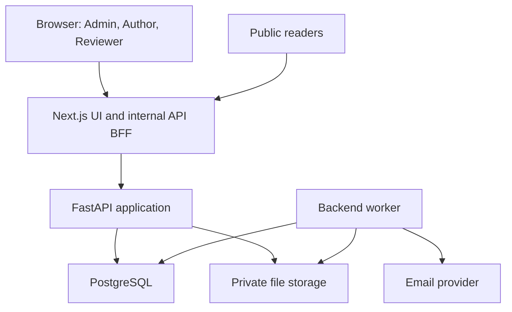
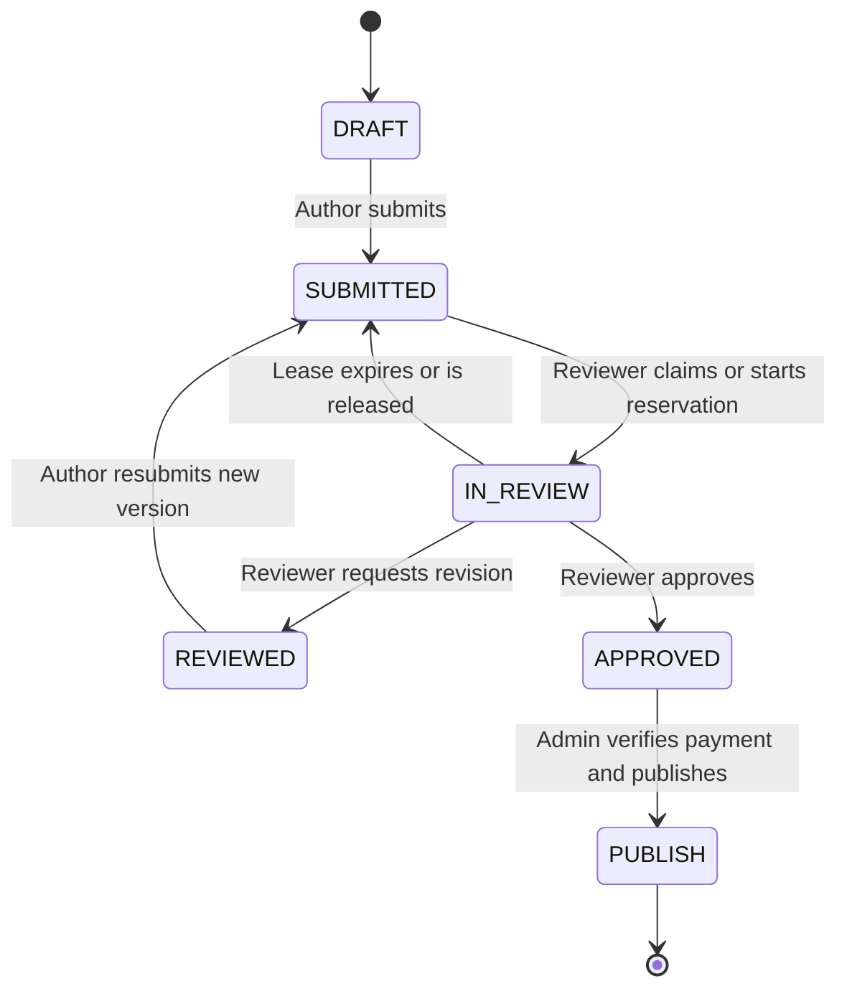

# Article Publishing Platform — Technical Design

Version 1.0 • 31 October 2026 • Implementation specification

## 1. Purpose and delivery boundary

Build a publishing platform for an article publishing firm, with Admin, Author and Reviewer roles. Authors submit structured manuscripts for journals, newsletters and other configured publication types. Subject-qualified reviewers claim submissions, request revisions and approve content. Authors then pay a configurable publication fee and upload proof. An administrator verifies receipt and publishes the approved version.

This package is a design and setup specification, not a completed or tested application. The two project folders contain README and configuration templates for implementation. Their commands describe the target projects once implemented; no executable application is represented as already present.

The deployable applications are:

1. **Frontend:** Next.js App Router, React and TypeScript; all browser data operations call same-origin `/api/v1/*` route handlers. These handlers form a backend-for-frontend (BFF) and call FastAPI over a private network.
2. **Backend:** Python, FastAPI, SQLAlchemy and PostgreSQL; owns identity, permissions, all business rules, transactions, migrations, file metadata and background processing. API and worker run as separate processes from the same backend project/image.

Next.js requires JavaScript/TypeScript and a Node.js runtime. Python therefore belongs in the backend; a second Python server inside the frontend would duplicate responsibilities. If Python within the frontend is mandatory, that requires a separate clarified integration, rather than labeling Next.js as Python.

The platform has one firm/tenant in the first release. Reviewer subject subscriptions mean expertise/notification preferences, not paid memberships. One reviewer reviews an article at a time; parallel peer reviews and anonymous review are outside the initial workflow. Review content and unpublished manuscripts are private. Public reading is available only after publication.

## 2. Functional scope and policies

| Area | Required behavior |
|---|---|
| Identity | Author self-registration, verified email, login, logout and password reset; administrators approve/invite reviewers; no self-service administrator creation |
| Classification | Admin-managed subjects, publication types, outlets and versioned submission templates |
| Author submission | Metadata, manuscript, declarations and validation against the chosen template |
| Reviewer eligibility | Active, approved reviewer subscribed to the primary subject, excluding own/coauthored/conflicted submissions |
| Reviewer allocation | First eligible claimant obtains an exclusive lease; other claim attempts fail atomically |
| Time limit | Default 5 elapsed days, configurable; stored as an exact UTC deadline on each assignment |
| Feedback | Reviewer requests revision with structured comments, resulting in REVIEWED |
| Revision | Author submits a new immutable version plus responses; original reviewer receives a reserved assignment |
| Acceptance | Reviewer approval sets APPROVED and issues one fee request for the approved version |
| Payment | Default INR 2,500, configurable; author uploads proof and transaction reference; admin verifies against actual receipt |
| Publication | Admin verifies payment and confirms publication; final state code PUBLISH, UI label Published |
| Administration | Users, reviewer approval, subscriptions, articles, assignments, payments, templates, settings and audit views |
| Notifications | In-app and email, persisted through an outbox with retry and duplicate prevention |

### 2.1 Explicit default decisions

- Five days means 120 elapsed hours, including weekends, beginning when a reviewer claims an initial submission. Reserved revision assignments begin immediately at author resubmission. This avoids indefinite reservations awaiting a second claim.
- An expired revision reservation returns the article to the eligible subject pool. The preferred reviewer remains in history but no longer has exclusivity. If strict permanent continuity is required, an admin escalation policy must replace this fallback before implementation.
- Initial submissions remain SUBMITTED until claimed. Revision submissions remain SUBMITTED while reserved; the reviewer opens the reserved assignment to move the article to IN_REVIEW without resetting the deadline.
- An untouched reserved revision also expires after five days, even though its article status is SUBMITTED. Expiration is based on assignment deadline, not just article state.
- A reviewer can approve on any round, including the initial review. There is no artificial revision requirement or five-round limit. Administrators may introduce a round limit later.
- A reviewer may return an assignment voluntarily, with a reason; the article returns to the pool. No rejection state is added to the requested MVP. Editorial rejection/withdrawal can be designed later as explicit audited states.
- A revision is reserved to the reviewer who most recently requested changes. If that reviewer is disabled, unavailable, no longer qualified or conflicted, resubmission enters the pool and alerts administrators immediately.
- A reviewer losing eligibility has active assignments revoked by the same administrative transaction; articles return to the pool. Previously submitted reviews remain immutable.
- Configuration changes affect new assignments/invoices only. Existing deadlines and fees retain their snapshot unless an administrator performs an explicit audited override with notification.
- Invoice amount is the payable total. Tax breakdown and legal invoice requirements must be supplied by the firm before launch; the software does not infer a tax regime.
- Payment verification and publication are separate explicit actions. The admin UI may offer a single “Verify and publish” command, implemented as one atomic business transaction.

## 3. Architecture



### 3.1 Responsibility boundaries

| Component | Owns | Does not own |
|---|---|---|
| Next.js pages/components | Forms, navigation, role-specific views, presentation validation | Database access, authoritative permissions or state transitions |
| Next.js BFF | Same-origin endpoints, HttpOnly cookies, CSRF checks, forwarding, timeouts, sanitized errors | Fee calculation, reviewer matching, database rules |
| FastAPI routers | Request validation, authentication dependencies, response contracts | UI rendering |
| Domain services | Authorization, transitions, revisions, allocation, invoices and publishing | Email delivery inside user transactions |
| Repositories | Parameterized persistence, row locks and query pagination | Independent business decisions |
| Worker | Lease expiration, outbox delivery, reminders, file scanning and retries | Arbitrary unvalidated status edits |
| PostgreSQL | Source of truth, constraints, leases, history and durable jobs | Binary manuscript storage |
| File store | Private immutable originals, proof files, publication derivatives | Deciding who may download |

Use a modular monolith for the backend. Splitting the workflow into microservices would complicate atomic changes across assignments, versions and payments without a demonstrated scaling requirement. No Redis dependency is required for the first release: durable jobs and the outbox live in PostgreSQL. API and workers can scale independently.

### 3.2 Browser/BFF contract

Every browser request, including uploads/downloads, uses the frontend origin. Browser code never receives `BACKEND_API_URL` or directly calls FastAPI or storage. Next.js handlers map explicitly allowlisted paths and methods to a fixed backend base URL; arbitrary proxy destinations are forbidden. Forward only selected headers, preserve status and request IDs, and never relay backend cookies or internal diagnostic details automatically.

Authenticated pages use client data fetching through internal route handlers to honor the requested path consistently. Server-rendered public pages may call the same internal API through a fixed trusted origin; document the extra hop and use caching only for public published data. Never derive that origin from an untrusted Host header.

BFF sets no-store on authenticated responses. File uploads stream through BFF to FastAPI/storage with aligned request limits and timeouts; do not buffer large files or embed them in JSON. Local development uses a shared backend volume; production uses private object storage behind backend access checks. Public publication assets are also served through an approved frontend route in this design.

## 4. Actors and permissions

Roles can be combined through `user_roles`, although accounts have a selected UI role. Backend permission checks always use the full authenticated role set plus object ownership. A multi-role user cannot review their own work or verify their own payment.

| Action | Author | Reviewer | Admin |
|---|---|---|---|
| Create/edit draft | Own only | Only if also Author | View/support, no silent author impersonation |
| Submit/resubmit | Own only | Only if also Author | No implicit authorship |
| View submitted manuscript | Own | Eligible queue metadata; full file only while assigned | All |
| Claim article | No | Eligible subject; no conflict | Assign/reassign with reason |
| Write review/approve | No | Current unexpired assignee | Only if also qualified Reviewer and explicitly assigned |
| View review | Own article after submitted feedback | Own reviews and assigned history | All |
| Upload payment proof | Own approved article | No | No on author's behalf by default |
| Verify payment/publish | No | No | Yes; no self-verification |
| Manage subjects/settings/users | No | Own expertise/preferences only | Yes |
| Read public article | Yes | Yes | Yes |

Reviewer approval is administrative; subscribing to a subject does not by itself grant reviewer privileges. Subject changes on a submitted article require an admin action that revokes the old assignment and rematches reviewers. Authors cannot change subject or publication type on revisions without this process.

## 5. Article state machine

Database article status uses exactly `DRAFT`, `SUBMITTED`, `IN_REVIEW`, `REVIEWED`, `APPROVED`, `PUBLISH`. DRAFT is an internal pre-submission addition. Payment and assignment states are separate.



The reserved SUBMITTED-to-SUBMITTED expiration is an assignment event and is omitted from the diagram to keep the article lifecycle readable. Payment verification alone leaves the article APPROVED.

| From | Command | Guard | Result and side effects |
|---|---|---|---|
| DRAFT | submit | Author owns; required metadata/files valid and clean | Freeze v1; SUBMITTED; new review round; notify eligible reviewers |
| SUBMITTED, pool | claim | Eligible reviewer; no active assignment; revision unchanged | ACTIVE assignment; deadline = DB time + configured duration; IN_REVIEW |
| SUBMITTED, reserved | start | Reserved reviewer; before deadline; eligible | RESERVED becomes ACTIVE; IN_REVIEW; preserve deadline |
| IN_REVIEW | request revision | Active assignee; before deadline; feedback complete | Submitted immutable review; assignment COMPLETED; REVIEWED; notify author |
| REVIEWED | resubmit | Author owns; response and new clean version complete | Freeze next version; new round; SUBMITTED; reserve same reviewer or fall back to pool |
| IN_REVIEW | approve | Active eligible assignee; before deadline | Approval review; assignment COMPLETED; APPROVED; snapshot approved version; create invoice; notify author |
| SUBMITTED/IN_REVIEW | expire | Active/reserved assignment due | Assignment EXPIRED; clear reservation; SUBMITTED; notify eligible pool and previous reviewer |
| SUBMITTED/IN_REVIEW | release/revoke | Holder releases or admin revokes; reason | Assignment RELEASED/REVOKED; SUBMITTED; rematch and notify |
| APPROVED | verify payment | Admin; valid submitted proof and confirmed receipt | Payment VERIFIED; article stays APPROVED; notify author |
| APPROVED | publish | Verified full payment; approved version; required publication metadata | Create immutable publication; PUBLISH; timestamp; notify author |

No generic “PATCH status” endpoint exists. All transitions are commands executed by backend services. Unsupported transitions return 409. Updating approved/published manuscripts is forbidden; a post-publication correction workflow is a future feature, not an untracked file replacement.

## 6. Reviewer assignment, continuity and deadlines

### 6.1 Eligibility and matching

An article has exactly one primary subject used for routing and optional secondary subjects for discovery. Eligibility requires active verified account, approved Reviewer role and active primary-subject subscription. Exclude submitting author, coauthors mapped to accounts and declared conflicts. MVP reviewers declare conflicts on claim and may maintain a conflict record against an author/article. Queue listings show title, abstract, subject, submission date and assignment availability; manuscript files remain private until claim.

All eligible reviewers receive one availability event per pool-entry generation. Reviewers can filter by subject and oldest submission. A configurable concurrency cap limits each reviewer's ACTIVE plus RESERVED assignments. If no eligible reviewer exists, alert the admin; keep the article SUBMITTED. Do not repeatedly notify the same empty pool every worker cycle. Pool reminders may run daily with a new reminder key.

### 6.2 Claim transaction

1. Begin transaction; lock article row `FOR UPDATE`.
2. Lock claiming reviewer row, always in article-then-user order. This serializes concurrent claims by the same reviewer for workload enforcement.
3. Obtain fresh PostgreSQL `clock_timestamp()` after locks. Do not rely on an application timestamp captured before waiting for a lock.
4. Revalidate article status, current version/round, actor eligibility, reservation and workload; expire stale assignment within the transaction if needed.
5. Insert one ACTIVE assignment for the current round/version; snapshot duration and exact deadline; change article to IN_REVIEW; increment `lock_version`.
6. Append immutable status history and outbox events; commit. If another claimant won, return 409 `ARTICLE_ALREADY_ASSIGNED`.

A five-day “lock” is a persisted lease, not a five-day database transaction. Row locks are held only for the short mutation transaction.

### 6.3 Revision reservation

On resubmission, freeze the new version and create a new round linked to the review requesting changes. If its reviewer remains eligible and below the workload cap, create a RESERVED assignment with `assigned_at=now` and `due_at=now+duration`, while article remains SUBMITTED. Notify only that reviewer. Opening the assignment via an explicit `start` command changes it to ACTIVE/IN_REVIEW; page GET requests have no mutation side effects.

If capacity/eligibility prevents reservation, route to the general pool and alert the admin with the reason. Original reviewer preference remains visible. A late original reviewer has no write rights after expiration/reassignment. Revisions carry per-comment response text and prior-versus-current version links; any replacement reviewer can inspect complete submitted review history.

### 6.4 Expiration and races

Run a worker scan every 60 seconds for RESERVED/ACTIVE assignments with `due_at <= clock_timestamp()`. Use short transactions, locking article first and assignment second consistently with API services. Workers select candidate IDs without holding assignment locks, then attempt article locks with SKIP LOCKED and recheck conditions. This avoids inversion between worker and review-submit lock order.

A submitted review locks article then assignment, obtains fresh database time, checks actor, version, assignment state and `now < due_at`, then commits feedback/approval atomically. At or after deadline, reject with 409 `ASSIGNMENT_EXPIRED`, finalize expiration and notify after commit. A transaction admitted before the deadline may finish shortly afterward; admission time under the row lock is the defined boundary. Worker scans provide eventual visible status correction, while API checks enforce the exact deadline even during worker outages. Backend reads may expose computed `effective_assignment_state=EXPIRED` before persisted cleanup.

Expiry is idempotent: changing the assignment from ACTIVE/RESERVED to EXPIRED is conditional, and an outbox uniqueness key includes assignment ID and event type. Multiple workers cannot emit multiple availability generations for the same expiration. Restarted workers process all overdue leases, not just today's records. Reminder event keys include assignment and reminder offset; skip reminders for completed/expired assignments. Default reminder is 24 hours before deadline.

## 7. Submission formats and review content

Publication **type** is Journal Article, Newsletter Article or another admin-configured category. An **outlet** is a named journal/newsletter. A journal **issue** contains multiple articles; an article is not itself a journal. Issue selection may be deferred until admin publication.

An admin versioned template defines required fields, word-count ranges, abstract requirement, reference style, allowed file types, section names and declarations. Articles snapshot the selected template version on first submission. Initial supported manuscript uploads: DOCX and PDF; final publication uses a sanitized/approved PDF or controlled text rendering. Binary formatting checks cannot guarantee every editorial requirement: automatically validate metadata, extension/MIME, size and parseable word counts; show remaining formatting requirements as a reviewer checklist. No macros, scripts or arbitrary HTML execution.

Required baseline data: title, abstract where required, primary subject, outlet/type, keywords, author and coauthor names/affiliations/emails, manuscript, originality/copyright/conflict declarations. Optional supplementary files and ORCID text can be added. Author ordering and declarations are versioned with the manuscript. Public coauthor emails are hidden unless explicitly authorized.

Each review contains overall comments, structured checklist ratings, numbered comments with section/page references, optional annotated file and decision `REQUEST_REVISION` or `APPROVE`. Comments specify required/advisory changes. Draft reviews may autosave privately, but submitted reviews are immutable. Approval must confirm that all required comments are resolved or explicitly waived. Author revision responses map to submitted comment IDs. Assignment expiry preserves private draft text for its reviewer but never treats it as submitted feedback; only completed reviews are disclosed to the author/replacement reviewer.

## 8. Data model

Use UUID primary keys, UTC `timestamptz`, parameterized SQL and explicit foreign keys. Monetary values use integer minor units (INR 2,500 = 250000 paise); never floating point. Logical deletes/deactivation preserve financial and review history. All user-facing mutation entities carry created/updated timestamps and a `lock_version` where optimistic concurrency applies.

| Table | Key fields and relationships |
|---|---|
| users | id, normalized unique email, password_hash, display_name, active, email_verified_at |
| user_roles | user_id FK, role; composite primary key; ADMIN/AUTHOR/REVIEWER |
| reviewer_profiles | user_id PK/FK, approval_status, bio, approved_by, approved_at, available |
| subjects | id, unique slug, name, active |
| reviewer_subjects | reviewer_id FK, subject_id FK, active; unique pair |
| reviewer_conflicts | id, reviewer_id, article_id or author_user_id, reason; validate exactly one target |
| publication_types | id, code, name, active |
| outlets | id, type_id, name, slug, active |
| issues | id, outlet_id, volume, issue_number, label, publication_date |
| templates | id, outlet_id or type_id, version, validation_schema JSONB, instructions, active; immutable version |
| articles | id, tracking_number unique, author_id, primary_subject_id, outlet_id, template_id, status, current_version_id, approved_version_id, current_round_id, lock_version, submitted_at, published_at |
| article_subjects | article_id, subject_id; secondary subjects; unique pair |
| article_versions | id, article_id, version_number, metadata JSONB, manuscript_file_id, submitted_at, template_id; unique(article_id, version_number) |
| version_authors | id, version_id, sequence, user_id nullable, name, affiliation, email, corresponding; unique sequence per version |
| files | id, owner_user_id, article_id nullable, kind, storage_key unique, sha256, size_bytes, content_type, scan_status, created_at |
| review_rounds | id, article_id, version_id, round_number, predecessor_review_id nullable; unique(article_id, round_number) |
| review_assignments | id, article_id, round_id, version_id, reviewer_id, state, assigned_at, started_at, due_at, completed_at, duration_hours, end_reason |
| reviews | id, assignment_id unique, reviewer_id, version_id, decision, comments, checklist JSONB, submitted_at nullable |
| review_comments | id, review_id, sequence, section_ref, text, required; unique(review_id, sequence) |
| revision_responses | id, version_id, comment_id, response_text, resolution; unique(version_id, comment_id) |
| invoices | id, article_id, approved_version_id, invoice_number unique, amount_minor, currency, fee_policy_version, status, issued_at |
| payment_attempts | id, invoice_id, submitted_by, reference_normalized, paid_at, amount_minor, proof_file_id, status, verified_by, verified_at, rejection_reason |
| publications | id, article_id unique, version_id, issue_id nullable, slug unique, final_file_id, published_by, published_at, metadata JSONB |
| article_status_history | id, article_id, old_status, new_status, event_type, actor_id nullable, assignment_id nullable, reason, created_at |
| notifications | id, recipient_id, event_id, type, payload JSONB, read_at; unique(recipient_id,event_id) |
| outbox_events | id, aggregate_id, type, payload JSONB, dedupe_key unique, available_at, state, attempt_count, lease_until, last_error |
| email_deliveries | id, event_id, recipient_id, template_key, provider_id, state; unique(event_id,recipient_id,template_key) |
| settings_versions | id, version, values JSONB, changed_by, changed_at; immutable snapshots |
| audit_events | id, actor_id, action, entity_type/id, redacted_before/after JSONB, request_id, created_at |
| auth_sessions | id, user_id, refresh_token_hash, expires_at, revoked_at, token_family_id |
| one_time_tokens | id, user_id, purpose, token_hash unique, expires_at, used_at |
| idempotency_keys | actor_id, route, key, request_hash, response_code/body, expires_at; unique(actor_id,route,key) |

### 8.1 Relationships and integrity

Articles own versions and review rounds. Rounds reference one immutable submitted version and can have multiple historical assignments after expiration. Each assignment has at most one review; its `submitted_at` distinguishes draft from final. Invoices reference exactly the approved version. Payment attempts reference invoices; publications reference that same approved version.

Use composite uniqueness `(article_id,id)` on versions and rounds plus composite foreign keys on article current/approved references and assignments to prevent cross-article associations. Create circular current-version/current-round references in a later migration or as deferrable constraints; insert article before child rows, then set pointers within the transaction. Review/assignment/reviewer consistency uses composite references where practical plus service assertions.

Representative mandatory indexes/constraints:

```sql
CREATE UNIQUE INDEX uq_article_live_assignment
ON review_assignments(article_id)
WHERE state IN ('RESERVED', 'ACTIVE');

CREATE INDEX ix_assignment_due
ON review_assignments(due_at)
WHERE state IN ('RESERVED', 'ACTIVE');

CREATE UNIQUE INDEX uq_article_approval_invoice
ON invoices(article_id, approved_version_id);

CREATE UNIQUE INDEX uq_verified_invoice_payment
ON payment_attempts(invoice_id)
WHERE status = 'VERIFIED';

CREATE UNIQUE INDEX uq_verified_payment_reference
ON payment_attempts(reference_normalized)
WHERE status = 'VERIFIED';

CREATE INDEX ix_article_subject_queue
ON articles(primary_subject_id, submitted_at, id)
WHERE status = 'SUBMITTED';

CREATE INDEX ix_author_article_status ON articles(author_id, status, updated_at);
CREATE INDEX ix_notification_unread ON notifications(recipient_id, created_at)
WHERE read_at IS NULL;
```

Add CHECK constraints for valid state codes, positive amounts, currency `INR` for MVP, positive duration, `due_at > assigned_at`, nonnegative file sizes and valid conflict targets. Prevent duplicate normalized emails with a functional unique index on lower(email). Index all frequently joined foreign keys. Notification/outbox JSON payloads hold IDs and safe summary text, not file contents or credentials. Financial deletion uses RESTRICT. Configuration schema validation occurs before settings are persisted; role and state codes are enforced in database constraints.

The unique verified transaction reference assumes bank/UPI references are globally unique within the firm's receiving account; if multiple receiving accounts/providers are introduced, scope uniqueness to `(receiving_account_id, reference_normalized)`.

## 9. Payment and publishing

Approval creates one immutable fee invoice with default 250000 minor units and INR currency, tied to the approved version. Snapshot the payment destination instructions and fee settings version so later changes cannot silently change an existing request. APPROVED articles remain private until publication. Invoice states: OPEN, PAID, VOID. Payment attempt states: SUBMITTED, VERIFIED, REJECTED. No payment gateway is required for this release.

The author supplies payment reference/UTR, date, amount and PNG/JPEG/PDF screenshot. Store proof privately, scan it, and link it to the invoice. A screenshot is supporting evidence; administrator must verify reference, beneficiary, amount and receipt in the firm's bank records. Reject with a reason if inconsistent. Rejection leaves invoice OPEN and article APPROVED and permits a new attempt; old attempts are retained. Prevent multiple simultaneous SUBMITTED attempts per invoice with a partial unique index: `CREATE UNIQUE INDEX uq_pending_invoice_payment ON payment_attempts(invoice_id) WHERE status = 'SUBMITTED';`. Full payment in one transfer is the MVP rule; installment/overpayment/refund handling requires explicit admin resolution outside this flow.

Verification locks article, invoice and attempt in that order, checks exact amount/currency, clean proof, reference uniqueness and actor separation, then marks attempt VERIFIED and invoice PAID. Duplicate verification with the same idempotency key returns the previous result. Competing decisions return 409. Publishing locks article and invoice, verifies version and PAID status, validates publication metadata and clean final file, inserts publication and transitions PUBLISH in one transaction. Combined verify-and-publish runs both validations before committing either result.

Publication requires title, public author list, subject, outlet, stable slug, final approved artifact and publication timestamp; journal issue/volume fields are required only when its template demands them. Do not invent DOI/ISSN identifiers; allow admin entry after external issuance if applicable. Public URLs use `/articles/{slug}` and expose only publication metadata/final artifact. A different production PDF must be confirmed by the approving reviewer before publication; admin cannot swap accepted content without a new editorial approval workflow.

## 10. API contract

FastAPI prefix `/api/v1`; browser-facing Next.js prefix `/api/v1` maps to it. OpenAPI generated by FastAPI is the canonical machine-readable contract; generate TypeScript types from it in CI. Pagination uses opaque cursor plus `limit` (default 25, maximum 100), stable sort `(created_at,id)` and allowlisted filters. Timestamps are ISO 8601 UTC. IDs are UUIDs. Decimal money never appears as JSON float; use `amount_minor` and `currency`.

| Method and backend path | Actor and contract |
|---|---|
| POST /auth/register | Public; author name/email/password; 201 verification pending |
| POST /auth/verify-email | Public; single-use token; 204 |
| POST /auth/login | Public; credentials; access/refresh tokens returned server-to-server to BFF |
| POST /auth/refresh | BFF; rotating refresh credential; invalid/replayed token revokes session family |
| POST /auth/logout | Authenticated; revoke refresh session; 204 |
| POST /auth/forgot-password | Public; uniform 202, regardless of email existence |
| POST /auth/reset-password | Public; single-use token/new password; revoke sessions |
| GET /me | Authenticated profile and roles |
| GET /subjects, /publication-types, /outlets | Public taxonomy; active items only |
| GET /templates/{id} | Author/admin; versioned requirements |
| GET/POST /articles | Author's list / create DRAFT; admin can list all via admin path |
| GET/PATCH /articles/{id} | Authorized detail / author edit draft metadata using If-Match |
| POST /articles/{id}/submit | Author; expected_version; validate/freeze and 200 |
| POST /articles/{id}/resubmit | Author; new_version_id, response map, expected_version; 200 |
| GET /articles/{id}/versions | Owner/assigned reviewer/admin; immutable history |
| POST /articles/{id}/versions | Author in DRAFT/REVIEWED; create editable working version |
| PATCH /articles/{id}/versions/{version_id} | Author; only unsubmitted working version; If-Match |
| GET /articles/{id}/timeline | Owner/assigned reviewer/admin; authorized history |
| GET/PUT /reviewers/me/subjects | Approved reviewer; read/replace active expertise subscriptions |
| PATCH /reviewers/me/availability | Reviewer; availability boolean; does not silently abandon assignments |
| POST /articles/{id}/conflicts | Reviewer; declare conflict and relinquish own active assignment |
| GET /review-queue | Reviewer; safe metadata for eligible unreserved pool only |
| GET /assignments/me | Reviewer; reservations, active, completed, expired |
| POST /articles/{id}/claim | Eligible reviewer; expected_version; 201 assignment |
| POST /assignments/{id}/start | Reserved reviewer; 200; preserves deadline |
| POST /assignments/{id}/release | Assigned reviewer; reason; 200 |
| PUT /assignments/{id}/review-draft | Live assignee; feedback draft; does not change article state |
| POST /assignments/{id}/review | Live assignee; decision/feedback/comment IDs; finalizes exactly once |
| GET /articles/{id}/invoice | Owner/admin; invoice and safe payment instructions |
| POST /invoices/{id}/payment-attempts | Owner; amount/reference/date/proof_file_id; 201 |
| GET /invoices/{id}/payment-attempts | Owner/admin; authorized proof metadata |
| POST /files | Authenticated multipart; kind, article_id, file; 201 with PENDING scan |
| GET /files/{id}/download | Authorized user; stream content with attachment headers |
| GET /notifications | Authenticated; own notifications |
| POST /notifications/{id}/read | Recipient; idempotent mark read |
| GET /admin/users, /admin/reviewers, /admin/articles | Admin; paginated/filterable lists |
| POST /admin/reviewer-invitations | Admin; email and permitted subjects |
| POST /admin/reviewers/{id}/approve | Admin; audited reviewer approval |
| PATCH /admin/users/{id} | Admin; activation/allowed roles; reason; protect final active admin |
| POST /admin/articles/{id}/reassign | Admin; reviewer or return_to_pool, reason, expected_version |
| POST /admin/assignments/{id}/extend | Admin; new_due_at/reason; never resurrect expired lease |
| GET /admin/payments | Admin; submitted proofs and reconciliation fields |
| POST /admin/payment-attempts/{id}/verify | Admin; verified reference/receipt note; 200 |
| POST /admin/payment-attempts/{id}/reject | Admin; required reason; 200 |
| POST /admin/articles/{id}/publish | Admin; approved_version_id, final_file_id, publication metadata; 201 |
| POST /admin/articles/{id}/verify-and-publish | Admin; payment_attempt_id and publication payload; atomic 201 |
| GET/PUT /admin/settings | Admin; schema-versioned config; If-Match for write |
| GET/POST/PATCH /admin/subjects, /admin/outlets | Admin; taxonomy; deactivate referenced entries instead of delete |
| GET/POST /admin/templates | Admin; create immutable new template versions |
| GET/POST/PATCH /admin/issues | Admin; issue metadata and outlet relationship |
| GET /admin/audit-events | Admin; redacted audit search |
| GET /public/articles | Public; published only; subject/outlet/search filters |
| GET /public/articles/{slug} | Public; publication metadata only |
| GET /public/articles/{slug}/file | Public; approved publication derivative only |
| GET /health/live, /health/ready | Infrastructure; liveness / database and schema readiness |

Self-registration cannot accept a role field. Admin creation is a one-time backend CLI. No public endpoint changes review deadlines, fee values or publication flags directly.

### 10.1 Representative payloads

```json
POST /api/v1/assignments/{assignment_id}/review
Idempotency-Key: 9e7d48c4-implementation-generated-uuid
{
  "decision": "REQUEST_REVISION",
  "expected_article_version": 7,
  "summary": "Clarify the sampling approach.",
  "checklist": {"format_valid": true, "references_checked": true},
  "comments": [
    {"client_id": "comment-1", "section_ref": "Methods", "text": "State the sample size.", "required": true}
  ]
}
```

```json
{
  "id": "article-uuid",
  "status": "SUBMITTED",
  "lock_version": 8,
  "current_version_number": 2,
  "assignment": {
    "id": "assignment-uuid",
    "state": "RESERVED",
    "due_at": "2026-11-05T10:00:00Z"
  },
  "allowed_actions": ["VIEW", "VIEW_TIMELINE"]
}
```

The sample IDs are placeholders, not valid request UUIDs. Real responses compute `allowed_actions` from actor and state; invoice actions are omitted unless APPROVED/PUBLISH. UI never treats this hint as an authorization boundary.

Errors use a consistent envelope:

```json
{"error":{"code":"ASSIGNMENT_EXPIRED","message":"The review deadline has passed.","details":{"assignment_id":"uuid"},"request_id":"uuid"}}
```

Return 401 unauthenticated, 403 forbidden, 404 for missing or deliberately concealed objects, 409 for workflow/conflict/expired lease, 412 for stale If-Match, 413 oversized upload, 415 unsupported type, 422 invalid fields and 429 rate limiting. A 409 includes latest safe status so clients can refresh. Require `Idempotency-Key` on submit, resubmit, claim, review finalization, payment attempt, verification and publication. Scope to actor+route; same key/different request hash is 409; retain at least 7 days. Domain uniqueness constraints protect against duplicates after key expiry. Store the idempotency response in the same transaction as the mutation.

## 11. Authentication and security

FastAPI hashes passwords using Argon2id, issues short-lived access tokens and rotating opaque refresh tokens, and stores only refresh token hashes. Defaults: access 15 minutes, refresh 7 days. Logout revokes the session; privileged writes and all authenticated authorization checks confirm session active/user active against the database rather than relying solely on token expiry. One-time verification/reset tokens are hashed, expire and are consumed atomically.

BFF receives tokens server-to-server and stores them in HttpOnly, Secure, SameSite=Lax cookies scoped to `/`; use `__Host-` cookie prefixes in production. Never store credentials in localStorage. Protect state-changing browser routes using an allowlisted Origin check plus a session-bound double-submit CSRF token. Validate tokens/signatures/issuer/audience/expiry in FastAPI; never trust forwarded user IDs or role headers. Serialize concurrent refresh operations per session to avoid accidental refresh-token replay from parallel BFF requests; expired access requests can alternatively return 401 and let one client refresh operation retry safely.

Private networking/firewall limits backend access to BFF and worker/admin operations. Backend authorization remains mandatory even on private networks. Browser CORS is unnecessary when only BFF calls backend; do not enable wildcard credentials. BFF request signing, if added, authenticates the calling service but never replaces user authentication.

Files: UUID-based storage keys, sanitized original names, max default 20 MiB manuscripts/10 MiB proof, extension and MIME signature checks, antivirus quarantine, zip-bomb/parse resource limits, no public storage ACL, content-disposition attachment and nosniff headers. Pending/rejected files cannot be submitted, downloaded by other parties or published. Author uploads must match owned article; reviewer annotated files match live assignment; payment files match owned invoice. Limit upload size before streaming and enforce again while streaming. Clean orphaned uploads after 24 hours if unreferenced; preserve referenced immutable files according to retention policy. Dev scanning may use an explicitly labeled local stub; production readiness fails if scanning is disabled.

Use rate limits on login, password reset, claim and uploads, with shared database-backed enforcement for multiple replicas or an external gateway. Production requires TLS, secret injection, admin MFA through an identity provider or implemented second factor, dependency scanning, sensitive-field log redaction and encrypted backups. Audit admin settings, access changes, file access, editorial decisions, payment decisions and publishing. Never log passwords, tokens, manuscript content or raw payment proofs. Retention and deletion/export policy must be agreed with the firm; deletion removes personal fields where permitted while preserving auditable financial/history records under the agreed policy.

## 12. Notifications and durable processing

| Event | Recipients | Message/action |
|---|---|---|
| Initial submission/pool re-entry | Eligible active subject reviewers | Available for review; link to queue |
| Claim/start | Reviewer and author | Assigned; deadline visible to reviewer |
| Reservation on revision | Original eligible reviewer; author confirmation | Revised manuscript ready; exact due time |
| Deadline reminder | Assigned reviewer | 24 hours remaining |
| Assignment expiration | Former reviewer and eligible pool; author in-app | Lease ended / available again |
| Feedback submitted | Author | Review available; authenticated link |
| Approval/invoice issued | Author | Accepted; payable amount and payment instructions |
| Payment submitted | Administrators | Proof awaiting verification |
| Payment rejected/verified | Author | Reason or receipt confirmed |
| Published | Author | Public URL |
| No eligible reviewer/failed delivery | Administrators | Operational action required |

Write article changes, audit records and outbox event in one database transaction. Worker materializes in-app recipients and email delivery rows with unique keys. Recheck availability-event eligibility and assignment generation before dispatch; suppress obsolete queued availability events after claim. Email links never authorize an action or claim an article automatically.

Workers claim outbox rows using short leases and SKIP LOCKED, commit the claim, perform external I/O without holding database locks, then record result. Expired delivery leases are retryable after crashes. At-least-once email delivery is realistic: provider idempotency keys should be used where supported; provider timeout after successful send may still produce a duplicate. In-app rows are deduplicated transactionally. Retry exponential backoff with jitter, maximum 8 attempts, then mark FAILED and alert admin. Notification failure never rolls back editorial decisions. Manual replay retains the original event identity.

## 13. Frontend information architecture

| Area | Screens and behavior |
|---|---|
| Public | Home, published article catalog, subject/outlet filters, article detail, download, login/register |
| Author dashboard | Counts by state, drafts, submissions, pending revision/payment and timeline |
| Submission wizard | Type/outlet/subject, metadata/authors, declarations, file upload/scan, validation and submit confirmation |
| Article workspace | State badge, versions, submitted reviews, response-to-comments form, deadline/assignment summary, activity |
| Payment screen | Immutable fee/destination, reference/date/amount, proof upload, pending/rejected/verified state |
| Reviewer dashboard | Available subject queue, reserved/active assignments, due times, completed history |
| Review workspace | Version-aware file access, previous review/revision diff metadata, feedback draft, checklist and decision |
| Reviewer profile | Expertise subscriptions, availability and conflict declarations |
| Admin dashboard | Status totals, overdue/unassigned, payments pending, reviewer capacity and operational failures |
| Admin management | Authors/users, reviewer approvals, articles, reassignment/extensions, payment decisions, publish form, templates/settings |

Use clear labels: Submitted, In review, Changes requested (REVIEWED), Approved—payment pending, Approved—payment verification pending, Approved—ready to publish, Published. Payment-derived labels must not create extra article states. Show timestamps in the user's locale/timezone with UTC available; backend deadlines always use UTC. Countdown is informational and cannot authorize a late submission. On conflict/expired lease, preserve local draft, show safe explanation and refresh permissions. Forms require explicit confirmation before final review and publication. Support keyboard navigation, labeled inputs, accessible status alerts and responsive layouts.

## 14. Project structures

### Frontend target tree

```text
frontend/
  README.md
  .env.example
  package.json
  package-lock.json
  next.config.ts
  tsconfig.json
  Dockerfile
  src/
    app/
      (public)/articles/[slug]/page.tsx
      (auth)/login/page.tsx
      author/articles/[id]/page.tsx
      reviewer/assignments/[id]/page.tsx
      admin/articles/[id]/page.tsx
      api/v1/auth/{login,refresh,logout}/route.ts
      api/v1/[...path]/route.ts
      layout.tsx
    components/{forms,articles,reviews,payments,common}/
    lib/server/{backend-client,session,csrf,route-allowlist}.ts
    lib/{api-client,validation,formatting}.ts
    types/api.generated.ts
  tests/{unit,integration,e2e}/
```

Catch-all BFF handler uses an explicit method/path allowlist and separate auth handlers for cookie handling. Disable external redirects and avoid SSRF. No frontend database connection string is permitted. Only browser-safe values use `NEXT_PUBLIC_`. Keep business rules out of components.

### Backend target tree

```text
backend/
  README.md
  .env.example
  pyproject.toml
  requirements.lock
  Dockerfile
  compose.yaml
  alembic.ini
  migrations/
    env.py
    script.py.mako
    versions/
  app/
    main.py
    cli.py
    core/{config,security,errors,logging}.py
    db/{session,base}.py
    models/{users,taxonomy,articles,reviews,payments,notifications,audit}.py
    schemas/{auth,articles,reviews,payments,admin}.py
    api/{deps,router}.py
    api/v1/{auth,articles,reviewers,files,payments,admin,public}.py
    services/{workflow,assignments,reviews,payments,publishing,files,notifications}.py
    repositories/{articles,assignments,payments,outbox}.py
    workers/{main,expiry,outbox,reminders,file_scan}.py
    integrations/{storage,email,scanner}.py
  tests/{unit,integration,api}/
```

The included setup-template folders deliberately contain only specification files, not empty code files that appear functional. Implement the target modules and dependency manifests before executing application commands.

## 15. Configuration and migrations

Environment examples are provided separately. Commit `.env.example` with placeholders, never real `.env` files. Startup validates required settings and rejects missing secrets or unsafe production defaults. Admin settings in database override environment defaults for business policy after initial bootstrap; infrastructure/security settings remain environment managed. Read assignment/fee settings transactionally and snapshot policy version.

Default business configuration: review period 120 hours, fee 250000 minor units INR, expiry scan 60 seconds, reminder 24 hours before deadline, max 5 concurrent live assignments, 20 MiB manuscript and 10 MiB proof. The workload cap is a proposed default, distinct from the required five-day deadline. Review duration can be represented in hours to avoid ambiguity and retain fractional-day flexibility.

Backend migrations use Alembic with SQLAlchemy metadata imports. `migrations/env.py` obtains the database URL from validated settings, not hard-coded `alembic.ini` credentials. API runtime never uses `create_all()` in production. Suggested migration sequence:

1. `0001_identity_taxonomy`: users/roles/sessions/tokens/subjects/templates/outlets/settings.
2. `0002_articles_files`: files, articles, versions, authors and secondary subjects.
3. `0003_reviews_workflow`: rounds, assignments, reviews/comments/responses, history; add circular references and lease indexes.
4. `0004_payments_publications`: invoices, attempts, publications, uniqueness constraints.
5. `0005_outbox_audit`: notifications, deliveries, outbox, audit/idempotency and query indexes.

Every revision includes upgrade/downgrade where safely reversible; destructive rollback is not guaranteed and must restore a backup or roll forward. Review autogenerated changes, particularly state constraints, partial indexes and data backfills. Run fresh-database and prior-release upgrade tests in CI. Production runs one migration job before application rollout, never one per API replica. Use expand/backfill/contract for breaking changes and verify current revision in readiness checks. Taxonomy/template seeding is idempotent and separate from schema migrations; bootstrap admin uses an interactive secret input.

## 16. Deployment and operations

Development services: frontend on 3000, backend on 8000, PostgreSQL on 5432, local SMTP capture on 1025/8025, scanner on configured endpoint and shared local upload storage. Compose belongs to backend and defines db/api/worker/mail/scanner services; frontend can run using npm or attach as a container via an optional integration compose file. Host BFF uses `http://127.0.0.1:8000`; containerized BFF uses `http://api:8000` on the private compose network. Never expose the database or storage publicly in production.

Production: TLS ingress to Next.js, private FastAPI service, managed PostgreSQL, private object storage and email provider. One backend image runs API and worker commands separately. API replicas are stateless except durable database/storage; workers coordinate through database leases. Use separate migration credentials with DDL privileges and least-privilege API/worker accounts. Support graceful shutdown: stop acquiring jobs, finish or release current leases, reject new requests and close DB pools.

Initial engineering targets, subject to load testing: 100 concurrent authenticated users, 10,000 articles/year, p95 ordinary metadata API latency under 500 ms excluding uploads/scanning/email, 99.5% monthly application availability, expiry cleanup within 2 minutes when worker healthy, notification dispatch within 2 minutes when provider healthy. These are design targets, not measured guarantees.

Metrics: HTTP latency/error rate, DB pool utilization/lock waits, queue age, expired-but-unprocessed assignments, worker heartbeat, outbox retries, failed email, quarantined files, payment backlog, time from submission to claim and publish. Propagate request/event IDs across BFF/backend/worker. Alert on missing worker heartbeat for 2 minutes, expiry lag above 2 minutes, persistent failed jobs and growing notification queue.

Backups include database and file store together. Proposed RPO 1 hour and RTO 4 hours require managed point-in-time recovery plus object versioning and verified restores; they are targets to validate, not properties of a daily dump. Conduct restore drills before launch and periodically afterward. Retain audit/history under the firm's agreed retention policy and restrict backup access.

## 17. Acceptance and test specification

| Scenario | Required result |
|---|---|
| Submit complete article | One immutable v1, SUBMITTED and one pool-entry notification event |
| Invalid format/quarantined file | 422, no submission or reviewer notifications |
| Reviewer unsubscribed/wrong subject | No queue access/claim; 403/404 as appropriate |
| Reviewer is author/coauthor/conflicted | Claim denied, including multi-role users |
| Two reviewers claim same article concurrently | Exactly one assignment; loser 409 |
| One reviewer claims two articles near cap | User-row serialization enforces cap |
| Initial claim | IN_REVIEW with deadline exactly snapshot duration after DB admission |
| Request changes | REVIEWED; assignment completed; immutable feedback visible to author |
| Revision resubmission | New immutable version, SUBMITTED, reservation to eligible original reviewer |
| Start reserved revision | IN_REVIEW; original resubmission deadline unchanged |
| Unstarted reservation expires | Assignment EXPIRED; SUBMITTED available to pool |
| Deadline equality/late review | At now >= due_at submission denied; no completed review |
| Worker races with review submit | One valid serialized outcome; no completed-and-expired assignment |
| Worker outage then restart | All overdue leases reconciled; API blocked late reviews throughout |
| Old assignee submits after reallocation | Denied even if old draft exists |
| Reviewer disabled/subject removed | Live assignment revoked, pool/admin notified |
| Configuration changed mid-review | Existing deadline/fee unchanged; new records use new policy |
| Repeated approval/retried request | One invoice and one editorial approval |
| Screenshot uploaded | Remains APPROVED; no automatic payment verification or publication |
| Payment proof rejected | Invoice OPEN; prior attempt retained; author can upload replacement |
| Duplicate payment reference | Second verification rejected atomically |
| Publish before payment/with wrong version | 409; no public record/file exposure |
| Verify-and-publish fails publication validation | Neither payment nor publication committed |
| Cross-user file/detail request | No unauthorized manuscript, review or proof disclosure |
| Retry idempotency key with altered payload | 409; no second mutation |
| Email provider fails | Editorial transaction persists; retry/failure visible |
| Database migration upgrade | Fresh and prior-release databases reach expected schema with constraints |
| Restore drill | Articles, proofs and published artifacts match database references |

Use Python unit tests for transition guards; PostgreSQL integration tests for locking, timestamps, uniqueness and expiry (SQLite is insufficient); API tests for object access and validation; frontend component tests for role/state actions; Playwright E2E for author-submit → review → revision → approval → proof → admin publication. Deterministic deadline tests use an injected clock for unit cases and controlled database timestamps for integration cases, with real concurrency tests for lock waits. Test queue generation dedupe and refresh-token concurrency. Test upload size/signature/scanning and path traversal. Never automate real bank payments; use test proofs and mock reconciliation decisions.

## 18. Implementation sequence and completion criteria

1. Foundation: initialize both projects; settings/secrets validation; logging; PostgreSQL/Alembic; CI; identity/RBAC; taxonomy/templates.
2. Submission: draft wizard, versioned metadata/files, scanning and author workspace.
3. Review: eligibility queue, atomic claim, reservations/deadlines, feedback/revision, admin reassignment and worker/outbox.
4. Acceptance/payment: immutable approval invoice, proof submission, reconciliation and payment decisions.
5. Publication/admin: publication guards, public catalog, admin reporting/settings/audit.
6. Hardening: concurrency/access-control tests, migration/recovery drills, accessibility, performance checks and operational handover.

A phase is complete only when frontend and backend behavior, migrations, authorization, notifications and relevant acceptance tests work together. Final README files must replace target commands with verified commands, pin supported runtime/dependency versions, document API examples and recovery steps, and identify any remaining deployment assumptions.

Pre-launch firm decisions: final subject taxonomy and manuscript templates; payment destination and invoice/tax fields; public licensing/copyright text; reviewer approval criteria and conflicts policy; retention policy and production service provider choices. The fallback after reviewer timeout, five-day timing definition and workload-cap default above are explicit implementation defaults and can be changed by product approval before development.

## 19. Technical references

These sources support the implementation mechanisms; workflow policy is defined by this design.

- Next.js Backend for Frontend: https://nextjs.org/docs/app/guides/backend-for-frontend
- Next.js Route Handlers: https://nextjs.org/docs/app/getting-started/route-handlers
- PostgreSQL SELECT locking clauses: https://www.postgresql.org/docs/current/sql-select.html
- Alembic migration tutorial: https://alembic.sqlalchemy.org/en/latest/tutorial.html
