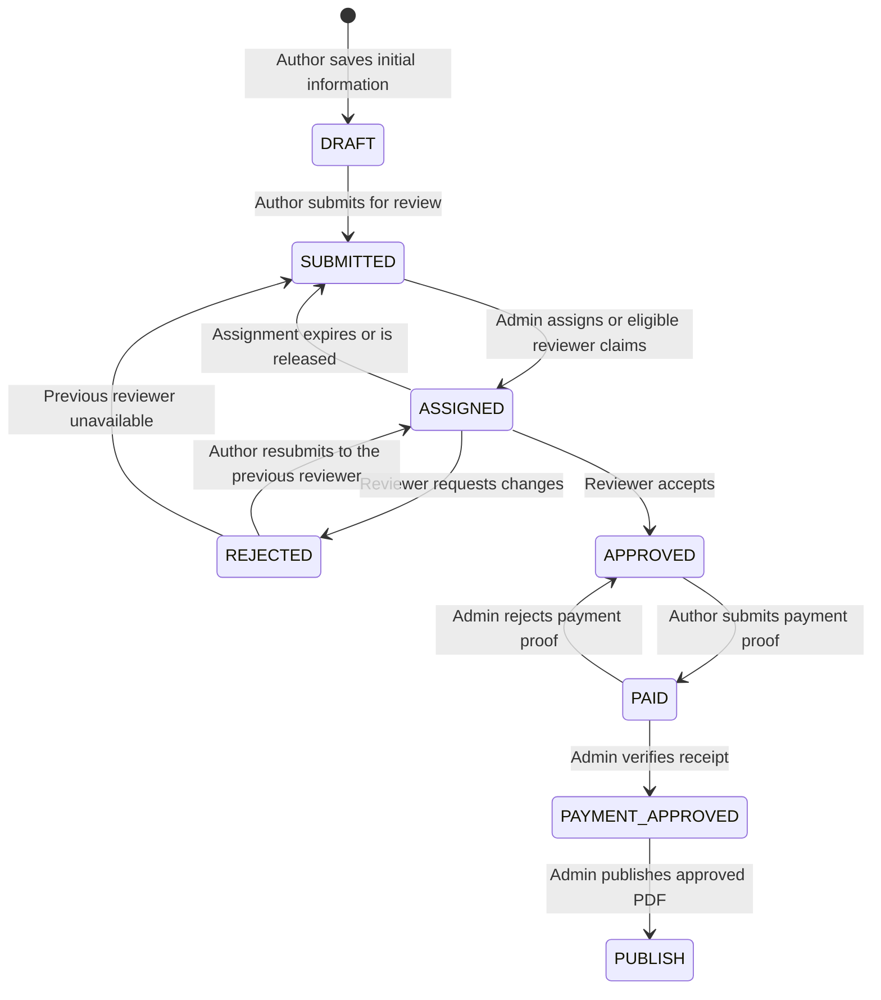

# Publishing frontend — implementation setup specification

This directory contains the Next.js frontend for the publishing application. It provides author, reviewer, and admin workspaces and proxies browser API requests to the separate backend.

## Article workflow



| Article status | Visibility and permitted actions |
| --- | --- |
| `DRAFT` | Only the author can view the article, its versions, activity, and files. The author can edit and save repeatedly. Admin article lists exclude drafts. |
| `SUBMITTED` | The author can track the article but cannot edit it. Admins and eligible reviewers of the same subject can view it. An admin can assign an eligible reviewer, or an eligible reviewer can claim it. |
| `ASSIGNED` | One reviewer holds the assignment. The author cannot edit the article, and admins cannot replace the assigned reviewer. The assigned reviewer can submit feedback or approve the article within five days. |
| `REJECTED` | This means changes requested, rather than permanent rejection. Only the author can revise the manuscript, respond to feedback, and resubmit a new version. Earlier submitted versions remain immutable. |
| `APPROVED` | The manuscript is locked. The author receives an approval email with the publication fee, payment instructions, and article link. The author pays and uploads proof. |
| `PAID` | Payment proof has been submitted and is awaiting admin verification. This status does not confirm receipt of funds or publish the article. |
| `PAYMENT_APPROVED` | An admin has verified the actual bank receipt, amount, and reference. The article is ready for a separate publication action. The UI displays this as “Payment approved.” |
| `PUBLISH` | The admin has published the approved PDF. The publication is available in the public library. |

### Saving a draft

The first tab saves the selected publication type, outlet, and submission template as a private `DRAFT`. Subject is selected on the second tab alongside the manuscript information. Saving that tab persists the subject as well as the title, abstract, keywords, authors, and declarations collected so far.

Draft saves send classification fields on both creation and updates. Returning to the first tab allows publication selections to be changed while the article is still a draft. Reopening the saved draft also lets its author select or change the primary subject. A draft may temporarily have no subject, but submission for review requires an active subject.

### Reviewer assignment and deadlines

- Admins assign from the eligible reviewer selector in the article workspace. Reviewers can inspect and claim available manuscripts through the review queue.
- Eligibility requires an active, email-verified, approved reviewer with matching subject expertise, available capacity, and no author, coauthor, or declared conflict of interest.
- Both assignment paths require an unassigned `SUBMITTED` article. The backend uses locks and a unique live-assignment constraint to prevent concurrent claims or replacement of an existing assignment.
- The review deadline is fixed at **120 hours (five days) from assignment** and cannot be extended. Late review submissions are rejected even if the expiry worker is stopped.
- The expiry worker returns overdue assignments to `SUBMITTED`. Released or revoked assignments also return to the queue.
- Resubmission automatically assigns the previous reviewer a new five-day review when they remain eligible, available, and within capacity. If they cannot take it, the article returns to the unassigned queue and admins are notified.

### Review and revision

The reviewer submits either approval or a request for changes. Change requests must include structured comments. The author can edit again only after the article reaches `REJECTED`, must address required comments, and can upload a replacement manuscript or retain the existing document. Resubmission creates a new immutable version and review round, then assigns the previous reviewer a fresh five-day deadline by default.

### Payment and publication

Approval creates an invoice that snapshots the fee and payment instructions for the approved manuscript version. Admins configure fees and bank instructions under **Settings & templates → Workflow settings**; later changes do not alter existing invoices.

The author uploads payment proof and supplies the transaction reference and payment date. An admin checks the actual bank receipt before approving it. Rejected proof returns the article to `APPROVED`, allowing corrected proof to be submitted. Authors cannot verify their own payments, even if they also have an admin role.

Payment approval does not automatically publish an article. Publication is a separate admin action that requires verified payment and the same approved final PDF. Published metadata and files become public; private reviews and payment proofs do not.

### Backend requirements

The backend enforces every transition and permission; frontend controls reflect those rules. Apply backend migrations through `0009_draft_subjects` before using this workflow, then restart the API and worker. The worker processes notifications, email deliveries, and assignment expiry; SMTP must be configured for email delivery. See the [backend README](../backend/README.md) for setup and migration instructions.

Migration `0008_article_workflow` maps legacy `IN_REVIEW` to `ASSIGNED` and `REVIEWED` to `REJECTED`, derives payment states from existing records, and aligns active assignment deadlines with the fixed five-day policy.

## Target stack and prerequisites

Next.js App Router, React, TypeScript and Node.js. Select a supported Next.js release and compatible Node LTS version during initialization; pin versions in package.json, package-lock.json and the Docker image. Python services belong to the separate backend. No database credentials or business-state logic belong here.

## Initialize the project

From the parent directory, move these specification files aside if the generator requires an empty target, scaffold `frontend` using the official create-next-app CLI with TypeScript, App Router, src directory and ESLint, then restore README.md and .env.example. Implement the BFF and UI described in the design before claiming workflow support. Commit the generated package-lock.json.

## Environment

```bash
cp .env.example .env.local
```

Set BACKEND_API_URL to the backend's private address, APP_ORIGIN to the trusted browser origin and INTERNAL_APP_ORIGIN to the trusted Next.js server origin. No backend setting uses NEXT_PUBLIC_. The `.env.local` file must be ignored by git. Replace all placeholders; production startup must reject insecure/missing security values. Use injected secrets in production.

## Run after implementation

Start backend/database/worker first using the backend README.

```bash
npm ci
npm run dev
```

Open http://localhost:3000. Browser requests use relative `/api/v1/*`; Next.js handlers call the backend. In a container BACKEND_API_URL is typically http://api:8000; on the host use http://127.0.0.1:8000. Never expose backend URL through browser bundles.

Target package scripts must define `dev` (next dev), `build` (next build), `start` (next start), `lint` (ESLint), `typecheck` (tsc --noEmit), `test` and `test:e2e` (Playwright).

## Build and checks after implementation

```bash
npm run lint
npm run typecheck
npm test
npm run test:e2e
npm run build
npm start
```

## Generate and maintain API types

FastAPI exposes the backend API contract at `/openapi.json`. Generate `src/types/api.generated.ts` from this schema using the exact `openapi-typescript` version pinned in `package.json` and `package-lock.json`. Run these commands from the frontend directory with the development or test backend running:

```powershell
npm ci
$env:OPENAPI_SCHEMA_URL = 'http://127.0.0.1:8000/openapi.json'
npm run api:generate
npm run typecheck
```

Commit the generated file alongside any affected frontend changes. Import generated request/response types into API calls and adapt the UI to the backend contract instead of maintaining conflicting handwritten types. Generating the file alone does not fix mismatched field names or response shapes. Do not manually edit generated output.

## Fail CI on API contract drift

CI must start an isolated backend test instance with its dependencies and migrations, wait until it is ready, and make its OpenAPI schema available. From the frontend directory, run:

```powershell
npm ci
$env:OPENAPI_SCHEMA_URL = 'http://127.0.0.1:8000/openapi.json'
npm run api:check
npm run typecheck
```

Use the backend test service address appropriate to the CI network; loopback is only correct when the backend is reachable there. The `api:check` script regenerates types in a temporary directory and compares them with the committed `src/types/api.generated.ts`. It exits nonzero on drift, generation failure, or missing schema configuration. Configure CI to stop on a nonzero exit; these commands document the required checks and do not themselves install a CI workflow. Keep the schema accessible in development/test even if it is disabled in production.

When a check fails because the API changed, run `npm run api:generate` locally, update affected frontend code, rerun checks, and commit the changes together.

## Use an actual backend for integration tests

Integration tests must call a running backend with a dedicated test database, migrations, and test configuration. Never point them at production data. Start the backend test environment using the backend README, then run from the frontend directory:

```powershell
$env:TEST_BACKEND_URL = 'http://127.0.0.1:8000'
npm test
```

The existing real-backend checks verify readiness, required OpenAPI paths, and unauthenticated access rejection. They skip when `TEST_BACKEND_URL` is absent, so CI must set this variable when integration verification is required. Browser tests that intercept API responses verify UI behavior, not actual backend integration. Full submission, review, revision, approval, payment verification, and publication workflows require additional tests against the real backend environment.

## Keep backend documentation private in production

Do not expose backend `/docs`, `/redoc`, or `/openapi.json` through public production ingress. One option is to disable these endpoints when constructing the production FastAPI application:

```python
app = FastAPI(
    docs_url=None,
    redoc_url=None,
    openapi_url=None,
)
```

Apply this configuration only in production; keep documentation/schema endpoints enabled in development and test environments for type generation and checks. If production documentation is needed internally, restrict it through authenticated private access. Keep the backend on private networking and route browser requests through the frontend BFF. This README documents the deployment requirement; it does not change backend configuration or ingress rules.

## BFF requirements

- Implement explicit path/method allowlisting under app/api/v1; special auth handlers manage cookies.
- Preserve API status, request IDs and safe error codes; sanitize upstream failures.
- Keep auth tokens in Secure HttpOnly SameSite cookies; validate Origin and CSRF on mutations.
- Coordinate refresh calls per session to prevent rotation races.
- Set authenticated responses no-store and prevent shared-cache leaks.
- Stream bounded multipart uploads and downloads; align ingress limits with backend.
- Use role-specific layouts for presentation, but enforce all permissions in backend.
- Do not create Python endpoints, direct SQL calls, arbitrary URL proxies or browser-side backend calls.

## Troubleshooting

502: verify BACKEND_API_URL from the Next.js process/network. 401: inspect session expiry and refresh flow without logging tokens. CSRF failures: check exact APP_ORIGIN, forwarded HTTPS configuration and cookie domain/path. Upload errors: align BFF/ingress/backend limits and check scanner readiness. Article 409: refresh state; do not blindly repeat workflow commands with new idempotency keys.
